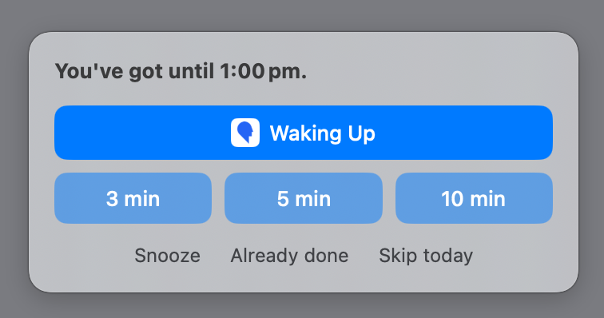
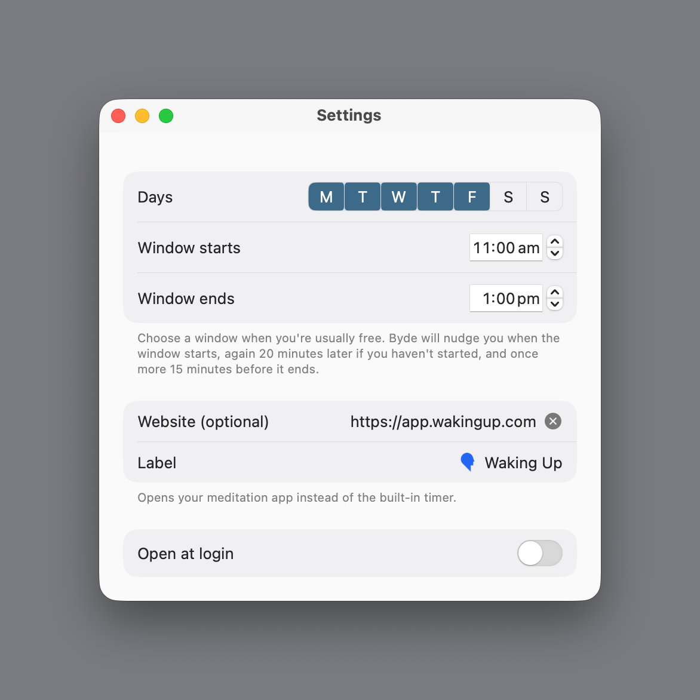
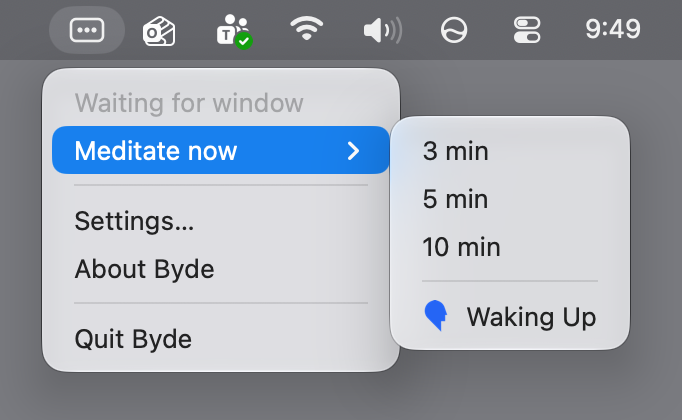

# Byde

A gentle nudge to meditate, once a day, inside a window you choose.

## Why I built it

My mornings are busy. Getting ready, the school run, then straight into early meetings. If I didn't meditate before all that, it didn't happen, so I wanted something that would catch me later in the day, once I actually had time.

I already had a habit tracker with reminders, but due to busyness I often swiped them away without reading them. So Byde doesn't send notifications. It shows a small panel that stays put until you decide: meditate, snooze for ten minutes, or skip today. If you ignore it, it asks again, and once your window closes, it leaves you alone until tomorrow.

## Screenshots

**The nudge panel** <br><br>


**Settings** <br><br>


**The menu bar menu** <br><br>


## How it works

Byde lives in the menu bar. It has no Dock icon.

**The window.** In Settings you pick the days of the week (Monday to Friday by default) and a start and end time (11:00 to 13:00 by default). Byde only nudges you on those days, inside that window.

**The nudges.** Each nudge is a small floating panel that stays until you answer it. It never takes keyboard focus.

1. The first nudge appears when the window starts.
2. If you have not started, a second nudge appears 20 minutes later.
3. A last nudge appears in the centre of the screen 15 minutes before the window ends.

If the window is shorter than 20 minutes, you get the first nudge only. If your Mac was asleep when nudges were due, you see only the most recent one when it wakes, as long as the window is still open.

**Your choices.**

- **3, 5 or 10 min** starts a timer. A full-screen view shows a 10-second countdown, then the timer. A bell sounds when it ends, and the end screen shows how many minutes you completed. Press Esc at any point to end early.
- **Snooze** hides the panel and shows the first nudge again 10 minutes later. The last nudge has no Snooze.
- **Already done** counts today as done without a timer.
- **Skip today** stops all nudges for the day.

Only a timer that runs to the end counts as a session. Ending early leaves the day as it was.

**Meditation website (optional).** In Settings you can add the address of your meditation app or website. (Apps that have websites include Waking Up, Headspace and Calm.) A button for it then appears on the nudge panel, and in the menu under Meditate now. Opening it counts as meditating for the day. Byde fetches the site's name and icon once, when you save the address.

**Meditate now.** The menu bar menu has a Meditate now item (3, 5 or 10 minutes). It works at any time, on any day, inside or outside the window.

**The menu bar icon.** The icon is a framed pause symbol. It shows an outlined frame while you are waiting, and a solid frame once you have completed a session today. It goes back to the outlined frame at midnight. The menu also shows a short status line, such as "Waiting" or "Meditated."

## Install

### Homebrew (available from v1.0)

```
brew install --cask joshuakaufman/tap/byde
```

Byde is not notarised by Apple. The cask removes the macOS quarantine flag so the app opens normally. If you would rather not do that, use the DMG below.

### Download (available from v1.0)

1. Download the DMG from [GitHub Releases](https://github.com/joshuakaufman/byde/releases).
2. Drag Byde to Applications.
3. Open Byde. macOS shows a warning. Dismiss it.
4. Open System Settings, go to Privacy & Security, and click Open Anyway next to the message about Byde.

To start Byde when you log in, open Settings from the menu and turn on Open at login. If macOS asks, approve it in System Settings, under General, then Login Items.

## Build from source

Built and tested with Swift 6.4 on macOS 14 or later. There is no Xcode project; Byde is a Swift package.

Steps:

```
git clone https://github.com/joshuakaufman/byde.git
cd byde
./build.sh
```

This builds `Byde.app` in the project folder. Add `run` (`./build.sh run`) to open it afterwards. The app is signed ad hoc. To install it, copy it to `/Applications`.

A plain `swift build` makes a Debug build, which adds a Debug submenu for testing nudges without waiting. Release builds made by `build.sh` do not have it.

## Optional: Focus during sessions

Byde can turn a Focus on while you meditate. It looks for two shortcuts by name. If they exist, it runs them. If not, it does nothing.

1. Open the Shortcuts app.
2. Create a shortcut named exactly `Byde Focus On`. Add the Set Focus action and choose the Focus you want turned on.
3. Create a second shortcut named exactly `Byde Focus Off`. Add the Set Focus action and set it to turn the Focus off.

`Byde Focus On` runs when a timer session starts. `Byde Focus Off` runs when it ends, including when you end early.

## Privacy

Everything stays on your Mac. The only network use is fetching the page title and icon of the meditation website, once, when you save its address in Settings. If you do not set a website, Byde makes no network requests.

Byde keeps a simple log of nudges and your responses at `~/Library/Application Support/Byde/`, in one file per month (`log-YYYY-MM.jsonl`). Nothing in the app reads it and nothing is sent anywhere. The website's icon is cached in the same folder.

## Licence

MIT. See [LICENSE](LICENSE).
